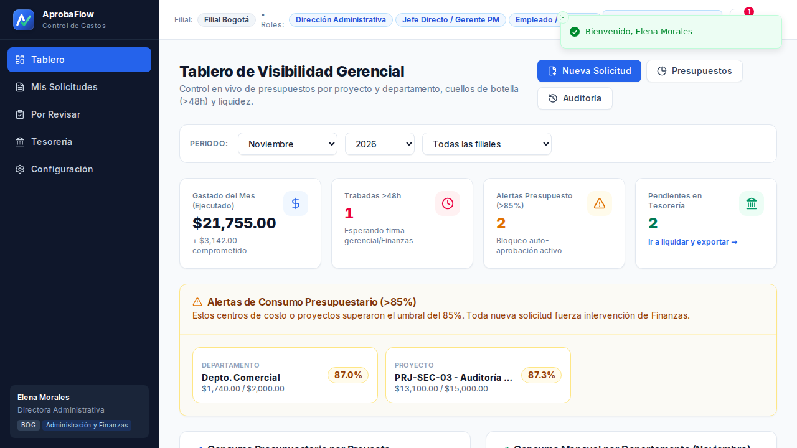
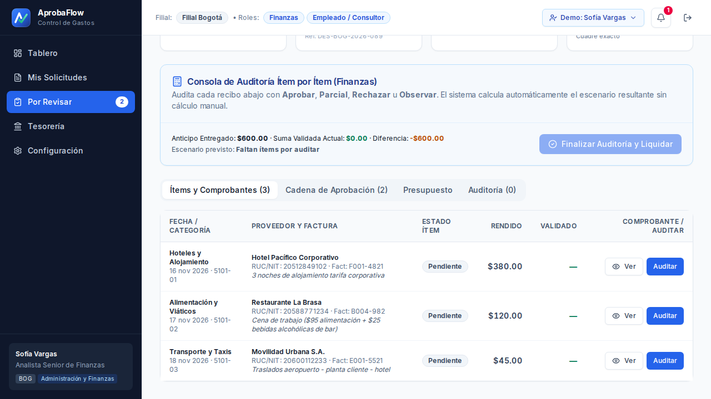
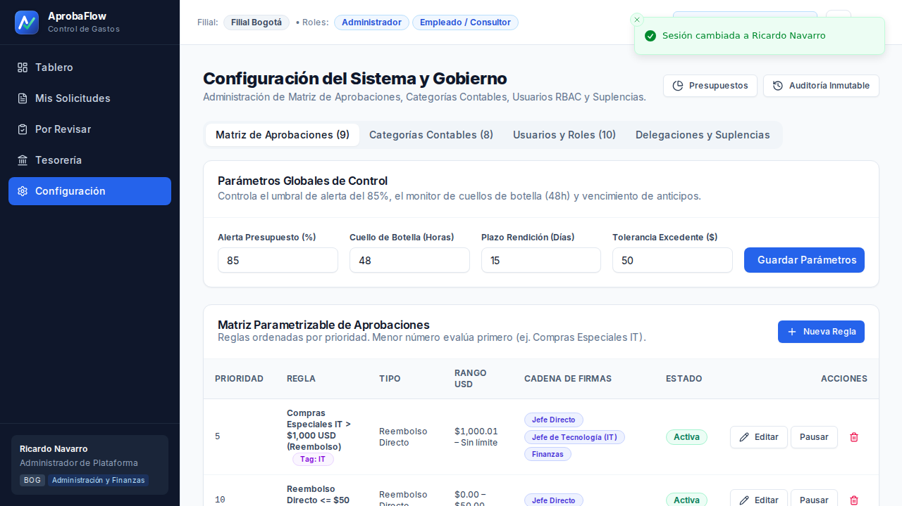
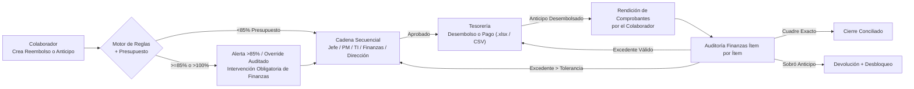

<div align="center">
  
  <h1>AprobaFlow</h1>
  <p><strong>Plataforma Corporativa de Control de Gastos, Anticipos, Presupuestos y Aprobaciones para Equipos Distribuidos</strong></p>

  <p>
    
    
    
    
    
    
    
    
  </p>
</div>

---

## El Desafío de Negocio

En consultoras y organizaciones con equipos distribuidos en múltiples sedes, el ciclo de viáticos, compras de equipamiento y suscripciones suele fragmentarse entre hojas de cálculo, correos informales y fotos de recibos enviadas días o semanas después. Esto genera:

- **Falta de trazabilidad**: nadie tiene certeza de quién aprobó un gasto ni bajo qué justificación.
- **Desvíos presupuestarios tardíos**: los excesos por departamento o proyecto se descubren semanas después de haberse consumido.
- **Cierres contables lentos**: contabilidad invierte días cuadrando comprobantes, calculando saldos de anticipos y persiguiendo firmas trabadas.
- **Auditorías vulnerables**: ausencia de una bitácora inmutable con fechas, roles, suplencias e IP de cada decisión.

## La Solución: AprobaFlow

**AprobaFlow** centraliza en una única plataforma web el ciclo completo de gastos corporativos: desde la solicitud previa o rendición directa con comprobante hasta la auditoría ítem por ítem de Finanzas, el control presupuestario preventivo y la conciliación final en Tesorería.

---

## Demo en Vivo de la Plataforma

> Recorrido funcional (~40 s): acceso por perfiles de rol, **Tablero de Visibilidad Gerencial**, alertas presupuestarias al 85%, bandeja separada **Por Revisar** con **Auditoría ítem por ítem (`ANT-2026-0004`)**, cola de **Tesorería**, administración de **Matriz de Aprobaciones / Categorías / Usuarios** y bitácora de **Auditoría Inmutable**.

<div align="center">
  <a href="https://github.com/Atrahasis-code/aproba-flow/releases/download/v1.0.0/aprobaflow-demo.mp4" title="Ver video HD 720p de AprobaFlow">
    
  </a>
  <p>
    🎥 <a href="https://github.com/Atrahasis-code/aproba-flow/releases/download/v1.0.0/aprobaflow-demo.mp4"><strong>Descargar / Ver video completo en MP4 HD (720p · 40 s)</strong></a>
    · <a href="./docs/media/aprobaflow-demo.mp4">Archivo en repositorio (<code>docs/media/aprobaflow-demo.mp4</code>)</a>
  </p>
</div>

---

## Capacidades Principales del Producto

### 1. Reembolsos Directos y Anticipos con Liquidación Automática
- **Dos modalidades integradas**: reembolsos de gastos ya incurridos (con comprobante obligatorio PDF/JPG/PNG/WEBP) y solicitudes de anticipo previo con desembolso y fecha límite de rendición.
- **Auditoría ítem por ítem en Finanzas**: cada factura de una rendición se valida individualmente (*Aprobado*, *Parcialmente Aprobado*, *Rechazado* u *Observado*).
- **Motor de 3 escenarios de liquidación**:
  - **Escenario A (Cuadre exacto)**: gasto validado coincide con el anticipo entregado y cierra automáticamente.
  - **Escenario B (Devolución a la empresa)**: saldo sobrante a devolver; bloquea preventivamente nuevos anticipos para el colaborador hasta adjuntar comprobante de depósito y recibir confirmación de Finanzas/Tesorería.
  - **Escenario C (Excedente al colaborador)**: reembolso adicional automático dentro de la tolerancia configurada o escalamiento a nueva cadena de firmas cuando supera el umbral.

### 2. Matriz Dinámica de Aprobaciones y Suplencias
- **Reglas parametrizables por prioridad**: evaluación según tipo de solicitud (`Reembolso`, `Anticipo`, `Excedente`), rango en USD, etiquetas de categoría (p. ej. `IT` para compras tecnológicas con intervención obligatoria de TI) y cadena secuencial de roles.
- **Delegación temporal y reasignación**: gerentes y aprobadores pueden delegar su bandeja por vacaciones o licencia con trazabilidad exacta (`"En reemplazo de..."`), o reasignar pasos puntuales sin romper la auditoría.
- **Gobierno administrativo completo**: creación, edición, activación/pausa y eliminación controlada de reglas, categorías contables y usuarios con validación de integridad referencial.

### 3. Control Presupuestario Preventivo (85% / >100%)
- **Presupuestos mensuales por Departamento y Proyecto** consolidando monto *Ejecutado* y *Comprometido*.
- **Alerta preventiva al 85%**: notifica automáticamente a responsables y deshabilita aprobaciones directas/automáticas, forzando revisión de **Finanzas**.
- **Límite estricto al >100%**: bloquea aprobaciones ordinarias y exige un **Override Presupuestario** explícito y auditado por **Finanzas** o **Dirección**.

### 4. Separación Estricta de Vistas, Tesorería y Auditoría
- **Mis Solicitudes vs. Por Revisar**: el solicitante visualiza exclusivamente su historial personal, mientras los revisores operan en un *Centro de Revisión* unificado con pestañas de *Pendientes de Firma*, *Auditoría Finanzas* y *Seguimiento de Terceros* y retorno contextual exacto.
- **Visibilidad ejecutiva de martes por la mañana**: KPIs mensuales por proyecto, centro de costo y filial, con alertas destacadas sobre solicitudes trabadas **>48 horas**.
- **Tesorería lista para conciliación**: colas dedicadas para desembolsos, verificación de devoluciones y pagos con exportación limpia a **Excel (`.xlsx`)** y **CSV**.
- **Auditoría inmutable**: bitácora filtrable por entidad, actor y acción con marca temporal, IP y snapshot de valores antes/después exportable en CSV.

---

## Vistas Destacadas

<table>
  <tr>
    <td width="50%">
      <strong>Tablero de Visibilidad Gerencial</strong><br />
      <sub>KPIs en tiempo real, solicitudes trabadas &gt;48 h y alertas automáticas de presupuestos sobre el 85%.</sub><br /><br />
      
    </td>
    <td width="50%">
      <strong>Consola de Auditoría Ítem por Ítem (Finanzas)</strong><br />
      <sub>Validación individual de comprobantes con cálculo automático del saldo neto de liquidación.</sub><br /><br />
      
    </td>
  </tr>
  <tr>
    <td colspan="2">
      <strong>Configuración de Matriz Parametrizable, Categorías y Usuarios RBAC</strong><br />
      <sub>Gestión completa de reglas de aprobación, parámetros de control (85% / 48 h / 15 días), categorías contables y roles.</sub><br /><br />
      
    </td>
  </tr>
</table>

---

## Flujo Operativo y Modelo de Roles (RBAC)



| Rol | Responsabilidades en la Plataforma |
| :--- | :--- |
| `EMPLOYEE` | Creación de solicitudes (reembolso o anticipo), carga de comprobantes, rendiciones y registro de depósitos de devolución. |
| `MANAGER` | Aprobación/observación de equipo directo y proyectos asignados, consulta presupuestaria y gestión de suplencias. |
| `SPECIAL_APPROVER_IT` | Firma obligatoria en solicitudes etiquetadas de tecnología e infraestructura según matriz. |
| `FINANCE` | Control presupuestario, override >100%, auditoría ítem por ítem de rendiciones y validación de devoluciones. |
| `TREASURY` | Ejecución de desembolsos de anticipos, confirmación de depósitos y pagos de reembolsos con exportación Excel/CSV. |
| `DIRECTION` | Visibilidad ejecutiva global, aprobaciones de alto monto/excedentes y override presupuestario estratégico. |
| `ADMIN` | Gobierno completo de reglas de aprobación, parámetros globales, categorías contables y usuarios/roles RBAC. |

---

## Arquitectura e Ingeniería

El sistema sigue una arquitectura **monorepo con Bun Workspaces** desacoplando por completo la interfaz de usuario, el servidor de dominio/API y el núcleo compartido de negocio con tipado estricto de extremo a extremo:

```text
aproba-flow/
├── apps/
│   ├── web/                # Frontend Next.js 16 (App Router) + React 19 + Tailwind CSS 4 + Eden Treaty
│   └── api/                # Backend ElysiaJS + Prisma 7 ORM + PostgreSQL 16 + ExcelJS + Vitest
├── packages/
│   └── shared/             # Tipos de dominio, aritmética monetaria segura y constantes compartidas
└── docs/
    └── media/              # Video demostrativo (MP4 / GIF) y capturas de producto
```

- **Tipado End-to-End**: los clientes frontend consumen directamente los contratos tipados del backend Elysia mediante **Eden Treaty** sin duplicación manual de DTOs.
- **Seguridad y Trazabilidad**: sesiones con cookies HTTP-only firmadas con **JOSE (JWT)**, contraseñas con **bcryptjs**, control de acceso basado en roles por endpoint y auditoría transaccional de cambios e IP.
- **Calidad Verificada**: suite de integración automatizada (**5 archivos · 18 pruebas en Vitest**) cubriendo cálculo presupuestario (85% / 100%), liquidación en 3 escenarios, suplencias, scopes de vistas, CRUD administrativo y exportaciones contables.

---

## Licencia

Distribuido bajo la licencia especificada en el archivo [`LICENSE`](./LICENSE).
